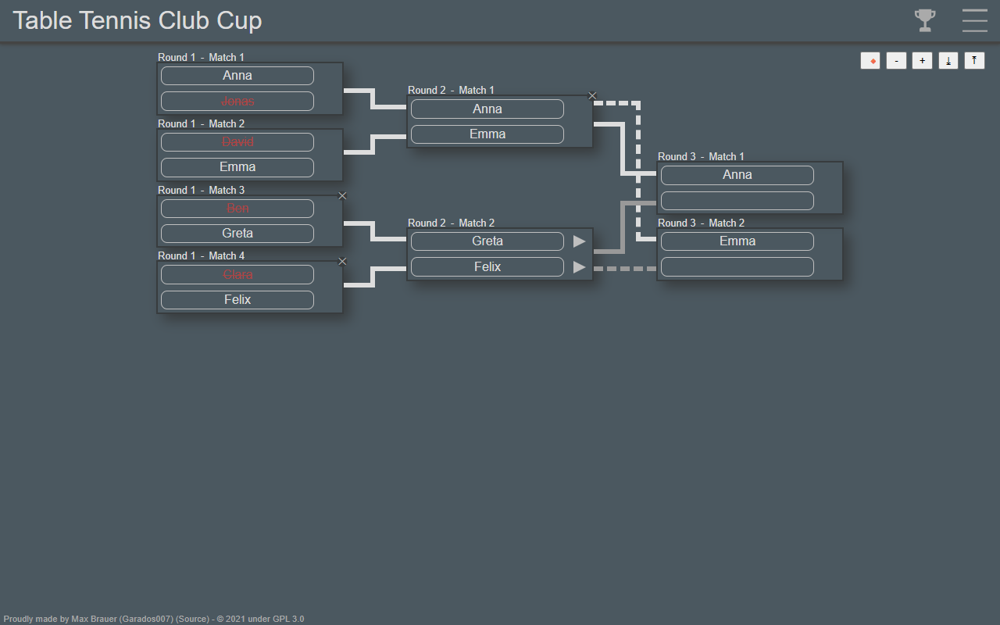
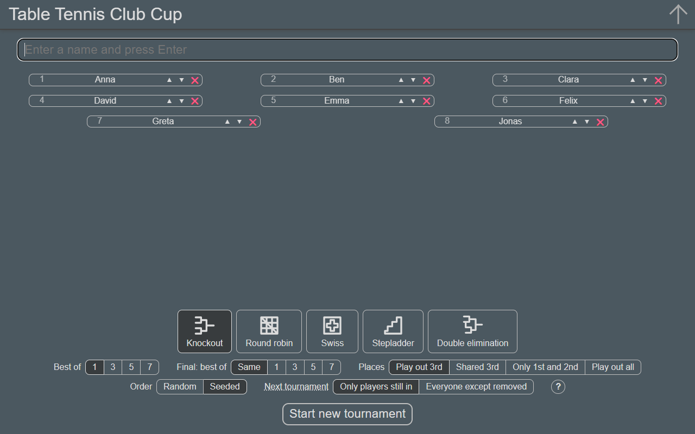
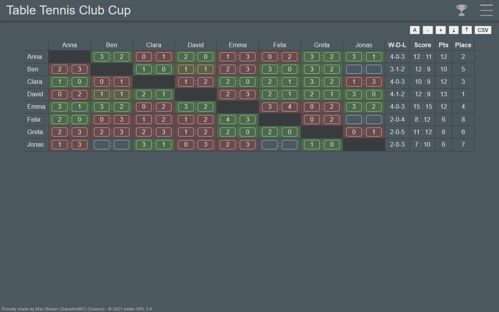
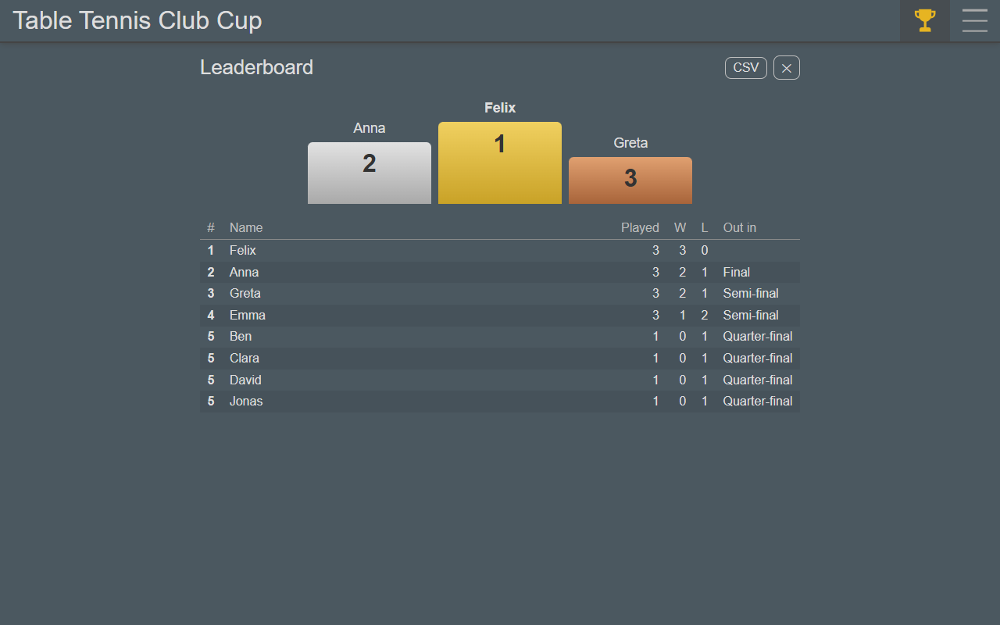

# Tournament

A tournament app for the web browser. One person, the editor, adds the players,
starts the tournament and enters the results. Everyone else opens the same link
and watches the bracket update live.

Try it at **<https://tournament.2complex.de>**. There is nothing to install and
no account.



## Features

### Modes

The editor picks the mode and its settings below the player list. The **?**
button explains every setting.



| Mode | How it works | Settings |
| --- | --- | --- |
| Knockout | Players drop out after their first loss. | Best of 1, 3, 5 or 7; a separate length for the final; places: play out the 3rd place, share it, award only 1st and 2nd, or play out all places in placement brackets |
| Double elimination | Players drop out after their second loss. The first loss moves them to the loser bracket, and the winners of both brackets meet in the grand final. Needs at least 3 players. | Best of N, final length, grand final reset on or off |
| Round robin | Every player plays every other player; the table decides the places. | Single matches or rematches; scoring with points or winner only; ranking by results (3 points per win, 1 per draw) or by total points |
| Swiss | A fixed number of rounds. Players with similar results meet, but never twice. | Number of rounds (automatic or 2 to 7); scoring with points or winner only |
| Stepladder | The two lowest seeds play first, the winner plays the next higher seed, up to the final against the top seed. | Best of N, final length |



### Players

- **Order:** random, or seeded in the order of the player list (move players
  with ▲ and ▼). Seeded knockouts keep the best seeds apart until late
  rounds; a seeded stepladder puts the first player at the top.
- **Joining late:** players added during a tournament still take part where the
  mode allows it. In a knockout a new player gets a match in the opening
  rounds while one is still undecided, in a round robin the table grows, and in a Swiss tournament they are
  paired from the next round on. A double elimination and a stepladder take
  new players only until the first result.
- **Leaving early:** a player removed during a tournament loses their open
  matches by walkover. The ↶ button undoes the removal as long as the
  tournament allows it.
- **Next tournament:** a new tournament starts either with only the players who
  are still in, or with everyone except the removed players.

### Editor and viewers

Opening the page without a link creates a new tournament, and the address bar
changes to a link like `https://tournament.2complex.de/?id=…`. Send this link
to the viewers. The browser that created the tournament is the editor; every
other browser that opens the link is a viewer and can only watch. In a bracket,
viewers can highlight a player's path by hovering over or tapping the name.

### Leaderboard

The trophy button opens the leaderboard: a podium for the first three places
and a table with the matches played, wins, draws and losses of every player.
While the tournament runs, the leaderboard is marked as provisional; when it
ends, the leaderboard opens by itself. The **CSV** button exports it for a
spreadsheet program.



### Import and export

The buttons above the bracket export the whole tournament to a JSON file, and
the editor can import it again, e.g. to continue it later or in another
browser. Round robin
and Swiss tables also export to CSV. Other buttons zoom, hide finished matches
in brackets and switch the column headers of a round robin table between names
and numbers.

## How it works

The app runs entirely in the browser. The editor's browser holds the
tournament and sends the complete state after every change to a websocket relay
([Websocket.Relay](https://github.com/Garados007/Websocket.Relay)), which
forwards it to all viewers of the same link. The relay only knows a group per
link and the last state for viewers who join later; nothing is stored on a
server.

The editor's browser keeps a copy of the tournament and the editor rights in
its localStorage. When the editor reloads the page or comes back later with the
same link, the app loads this copy and uploads it again.

The relay deletes a group shortly after its last connection closed.
When the editor comes back after that, the app creates a new group with the
saved copy, and the link changes; send the new link to the viewers. A viewer
who loses the connection can start a new tournament or host a copy of the last
state as a new editor.

Without a connection to the relay the editor can still run the tournament in
their browser, but nobody else sees it.

## Self-hosting

The `Dockerfile` builds the app and serves it with thttpd on port 3000:

```sh
docker build -t tournament .
docker run -d -p 8000:3000 tournament
```

The app is then available at `http://localhost:8000`.

By default the app uses the official relay `https://relay.2complex.de`, except
when it's opened on `localhost`: then it expects a local relay on
`http://localhost:8005`, as in development. It's
fine for small installations, but it's shared with everyone and comes without
guarantees. Big installations should run their own
[Websocket.Relay](https://github.com/Garados007/Websocket.Relay) and set its
address with `RELAY_URL`:

```sh
docker run -d -p 8000:3000 -e RELAY_URL=https://relay.example.com tournament
```

`RELAY_URL` is the address the *browsers* use to reach the relay, without a
trailing slash. The relay listens on port 8005 and speaks plain HTTP. If the
app is served over HTTPS, put the relay behind a reverse proxy with TLS that
forwards websocket connections, otherwise browsers block the connection.

An example `docker-compose.yml` with the app and its own relay, both built
from GitHub. Replace `localhost` with the address of your server:

```yaml
services:
  tournament:
    build: https://github.com/Garados007/Tournament.git#master
    ports:
      - "8000:3000"
    environment:
      RELAY_URL: http://localhost:8005
    restart: unless-stopped
  relay:
    build: https://github.com/Garados007/Websocket.Relay.git#master:Websocket.Relay
    ports:
      - "8005:8005"
    restart: unless-stopped
```

Start it with `docker compose up -d --build`.

## Development

The app is written in [Elm](https://elm-lang.org/) 0.19.3. Requirements:

- [Node.js](https://nodejs.org/) with npm
- [elm-live](https://github.com/wking-io/elm-live) for the dev server
  (`npm install -g elm-live`)
- [pre-commit](https://pre-commit.com/) for the formatting checks
  (`pre-commit install` once after cloning)
- Docker, only for the production image

All npm commands run in `ui/`:

```sh
cd ui
npm ci                     # elm, elm-test and elm-format in the pinned versions
npm run build              # compile check
npm test                   # Elm tests and JavaScript tests
PORT=8001 ./elm-live.sh    # dev server on http://localhost:8001
```

The dev server serves the same `index.html` as the production image and
recompiles on every change. On `localhost` the app connects to a local relay on
`http://localhost:8005`; start one from
[Websocket.Relay](https://github.com/Garados007/Websocket.Relay) or with the
relay service of the compose file above.

`ui/js/manual/websocket-relay.js` tests the websocket middleware against the
local relay, including a simulated network drop. It isn't part of `npm test`:

```sh
cd ui
node js/manual/websocket-relay.js
```

`pre-commit run --all-files` runs elm-format and the whitespace checks on all
files.

Layout of the repository:

- `ui/src/` Elm sources, `ui/tests/` elm-test suites and fixtures of the JSON
  format
- `ui/js/` JavaScript for the websocket and localStorage ports
- `ui/css/` styles
- `ui/vendor/` Elm packages that don't support Elm 0.19.3 yet
- `index.html` entry page, `Dockerfile` and `docker/` production image

## License

GPL 3.0, see [LICENSE](LICENSE).
